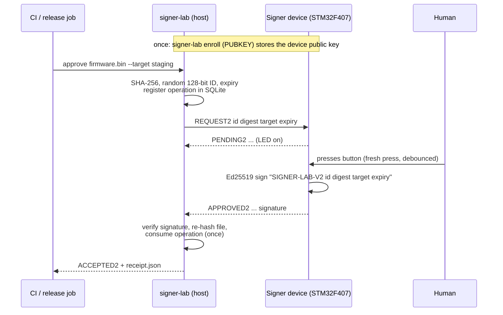

# firmware-signer-lab

[](https://github.com/denizkapici/firmware-signer-lab/actions/workflows/firmware-ci.yml)

A button-approved release signer: a custom STM32F407 board, bare-metal
firmware that signs a release only after a physical button press, and a
host client that turns that signature into a single-use deployment
approval. Developed and tested entirely in simulation (Renode) and CI.

> **Status: lab project (v0.3).** The device generates its own Ed25519 key
> on first boot from the hardware RNG and only ever reveals the public
> key. The key lives in ordinary MCU flash, so protect a real board with
> read-out protection; see [key management](docs/key-management.md), the
> [threat model](docs/threat-model.md) and the [roadmap](docs/roadmap.md).

## How it works



The signature binds the file digest, the deployment target and an expiry
time. The host accepts each approval exactly once, also across restarts and
concurrent processes. A receipt can be verified offline later.

## What is in the repository

| Part | Contents |
| --- | --- |
| [`hardware/`](hardware/) | KiCad 10 project: STM32F407VGT6 (LQFP-100), AP2112K-3.3 regulator, SWD, UART header, reset and approve buttons, status LED. 2-layer, 60 × 50 mm, ERC/DRC clean. |
| [`firmware/`](firmware/) | C11 and Thumb-2 assembly, no HAL or libc: startup and full vector table, interrupt-driven UART with ring buffer, approval state machine, hardware RNG and flash drivers, on-device key generation and key store, fault reporting, watchdog, Ed25519 via vendored [Monocypher](https://monocypher.org) 4.0.3. |
| [`simulation/`](simulation/) | Renode platform matching the board's pins (UART4, PA0 button, PD12 LED). |
| [`host/signer_lab/`](host/signer_lab/) | Python client: V2 protocol, PTY/serial transport, receipts, SQLite single-use store, CLI. |
| [`tests/`](tests/) | 72 Python unit tests; 28 Robot Framework tests in Renode (firmware behaviour, key generation and persistence, end-to-end host ↔ firmware, Ed25519 on Cortex-M4). |
| [`docs/`](docs/) | [Protocol](docs/protocol.md), [key management](docs/key-management.md), [threat model](docs/threat-model.md), [roadmap](docs/roadmap.md). |

## Quick start

Developed on Ubuntu 22.04 (aarch64); CI runs on Ubuntu 22.04 (x86_64).
Python 3.10 or newer.

```bash
sudo apt install gcc-arm-none-eabi binutils-arm-none-eabi python3-venv
python3 -m venv .venv && . .venv/bin/activate
pip install -r requirements/host.txt

./scripts/build-firmware.sh                         # firmware/build/signer.elf
python -m unittest discover -s tests -p 'test_*.py' # host tests, no device needed
```

Run the Renode tests ([Renode 1.17](https://github.com/renode/renode/releases/tag/v1.17.0)
with its `tests/requirements.txt` installed):

```bash
bash scripts/build-crypto-test.sh
SIGNER_HOST_PYTHON="$(command -v python)" /path/to/renode-test tests/*.robot
```

### Manual demo

Terminal 1 starts the simulated board with its UART on `/tmp/signer-uart`:

```bash
./scripts/run-renode.sh
```

Every new Renode session is a new, blank chip: the board generates a key
on boot. In terminal 2, enrol it once, then ask for approval:

```bash
./scripts/signer-lab enroll --port /tmp/signer-uart --key-out /tmp/device.hex

./scripts/signer-lab approve firmware/build/signer.bin \
  --port /tmp/signer-uart --database /tmp/approvals.sqlite3 \
  --target staging --receipt-out /tmp/approval.json \
  --public-key-file /tmp/device.hex
```

Press the button in the Renode monitor (terminal 1):

```
sysbus.gpioPortA.approveButton Press
sysbus.gpioPortA.approveButton Release
```

Then verify the receipt offline, and see that it cannot be used twice:

```bash
./scripts/signer-lab verify firmware/build/signer.bin \
  --receipt /tmp/approval.json --target staging --public-key-file /tmp/device.hex

./scripts/signer-lab accept firmware/build/signer.bin --receipt /tmp/approval.json \
  --database /tmp/approvals.sqlite3 --target staging --public-key-file /tmp/device.hex
# Error: Mismatched or already consumed approval.
```

## CI

Every push and pull request runs, on GitHub Actions:

- cppcheck on the firmware and ruff on the Python code;
- the Ed25519 known-answer test on the host;
- all Python tests;
- a firmware build with `-Werror` and strict warnings, with a size report;
- all Renode tests, including enrolment and a real approval over a PTY;
- offline verification of the receipt produced by that test, with the
  public key the simulated device generated.

Actions are pinned to commit SHAs and kept up to date by Dependabot.

## Limitations

- The key is in MCU flash; without read-out protection a debugger can
  read it (threat T1). Enrolment is trust on first use (T2a).
- No display: the button proves that someone was present, not that they
  saw what they approved (threat T5).
- Single use is enforced by the host database; rolling it back re-opens
  approvals (threat T7).
- The PCB has not been manufactured. Renode runs its own STM32F4 model, so
  the tests validate the firmware, not the copper.

## License

MIT, see [LICENSE](LICENSE). Monocypher is dual-licensed BSD-2-Clause /
CC0, see [firmware/vendor/monocypher/LICENCE.md](firmware/vendor/monocypher/LICENCE.md).
